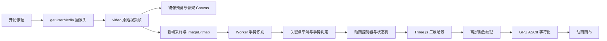
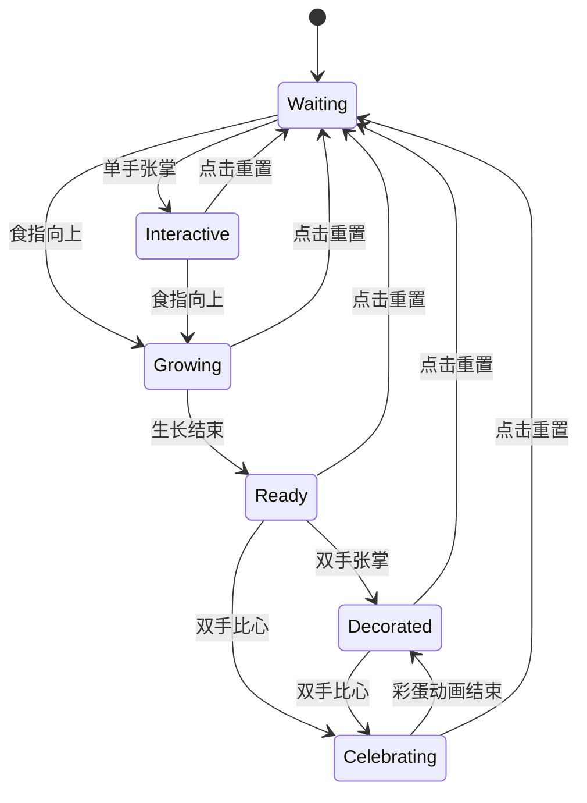

# 摄像头手势控制 ASCII 圣诞树 Demo 技术方案

核实日期：2026-11-21。当前已实现摄像头识别、Three.js 圣诞树和连续手势控制；下面原始视频采样及初版方案保留作参考，最新交互规则见本节与 README。ASCII 与麋鹿尚未接入。

### 当前交互规则（2026-11-22）

当前采用「竖食指作为操作开关 + 指尖移动距离推进」：允许画圈、椭圆、直线和来回摆动，不再要求证明圆弧或拟合圆心。按实际观测路径推进六层树冠，累计约六个手掌尺度的有效移动完成生长。捏合只切换到装饰模式，松开后再次竖食指移动，逐层增加彩灯与礼盒；装饰不超过已生长范围。

进度只在新识别结果中按距离增量更新，RAF 只负责渲染，不推进树冠或装饰。距离经视频宽高比校正、手掌尺度归一化；0.04 个手掌尺度且不少于 4 个输入像素的空间余量过滤微小抖动，慢动作可累积越过余量，停止后没有惯性或补进度。单帧位移超过 1.2 个手掌尺度视为跳点并重新建立起点。

上指分类阈值保留 0.30，也支持几何判定；已经进入控制时，分类短暂不确定且食指仍基本竖起可维持最多 600ms，明确张掌、握拳、收起食指或丢手立即停止；进入/离开姿态宽限的首帧重新建立起点。捏合采用距离迟滞，保持时只触发一次。暂停联动、关闭摄像头、丢手、换手及超过 750ms 的更新间隔均不补算缺失期间的移动，已完成进度保留。

模式切换、暂停/恢复或后台暂停时更新控制代次，拒收先前提交但晚到的识别结果，避免跨操作补算位移。

双手比心复用现有几何检测与 300ms 稳定窗口，优先于上指和捏合。保持只触发一次，解除后可再次触发，事件间至少 1 秒；仅手势联动开启时有效。烟花使用现有 GPU 粒子，独立于连续进度；部分树或零进度也能播放，不补齐树冠/装饰，不切换模式，重置时清除烟花。

单手三指捏合（拇指、食指、中指）控制额外一层落雪。三组指尖距离按视频比例和掌尺度归一化，进入/退出使用空间迟滞，不等待时间窗口；手势无效或丢手立即关闭发射。返回原始三指中心，场景接收 `1 - x` 镜像坐标，从屏幕顶部发射；顶部位置仅为使用提示，不是额外识别门槛。

落雪优先于两指切装饰和食指移动，结束后保留两指接触锁，直到完全松开再允许新的装饰命令。粒子使用固定 576 槽池与屏幕空间绘制，按每秒 108 片发射（初版 36 片的 3 倍）；单帧发射时间最多计 50ms。旋转/缩放树不会改变左右映射；新位置只影响新雪花，旧雪继续自然飘落。超过 750ms 无新输入时停止新粒子，不补发卡顿期间的雪；暂停、关闭摄像头、后台与重置均停止发射，重置另清空存量。这层雪独立于环境雪、烟花及生长/装饰进度。

大、小镜像预览同时显示当前控制手的指尖光点：绿色生长、金色装饰、冰蓝色三指落雪、灰色暂停。光点和骨架使用相同镜像变换，不增加位置缓动。

本轮未加入光流或其他高频追踪，指尖与进度仍按 MediaPipe 返回节奏更新。它降低了轨迹形状要求，但不能解决模型推理耗时或严重遮挡；真实摄像头的识别率和延迟需实机验证，合成关键点回放仅验证控制链路。

以下为初始技术方案与视频观察记录，早期静态手势映射和调参建议不代表当前实现。

## 1. 视频中实际展示了什么

来源：小红书「小饼干🍪lilian.chiuuu」的《DEMO｜vibecode了一个“最小可行性圣诞树”🥦》。使用用户提供的完整分享链接在浏览器打开，视频时长约 18.77 秒。

采样截图：[视频画面与时间点](evidence/video-contact-sheet.jpg)。

| 时间点 | 人的动作与画面变化 |
| --- | --- |
| 0.5 秒 | 张开一只手，摄像头画面叠加手部骨架，下方为黑色雪花背景。 |
| 3 秒 | 一手张开、另一手食指向上，下方开始出现圆形底座和树的底部。 |
| 5.5–8 秒 | 圣诞树逐渐长高，形成分层树冠和金色树顶星。 |
| 10.5 秒 | 食指向上，树上已有彩色灯带和装饰。 |
| 13 秒 | 双手张开，树下出现礼盒。 |
| 15.5 秒 | 双手比心，树前出现白色麋鹿轮廓。 |
| 18 秒 | 手离开比心姿势，完整圣诞树、礼盒与麋鹿仍然保留。 |

画面上方约三分之一为摄像头，下方为动画。动画中的树、地面、礼盒和麋鹿都呈现字符风格；字符整体按屏幕行列排列，并保留绿色、金色、红色、紫色等颜色。

这些截图证明画面变化和手势在时间上相邻。视频没有公开代码，也没有逐项解释控制规则，因此无法仅据此确认作者的框架、每个手势的准确语义，或排除部分动画同时由时间轴驱动。下面采用一套明确、可以测试的手势映射复现体验。

## 2. 推荐架构与技术选型

推荐纯浏览器应用：**Vite + TypeScript + Three.js WebGLRenderer + MediaPipe Tasks Vision Gesture Recognizer**。摄像头、推理、动画均在用户设备执行，静态站点即可部署，无需上传视频或使用服务端推理。

当前工作区没有应用源码或 package.json。以上是实施选型，本次未安装依赖。界面较小，可直接使用 TypeScript 管理 DOM；实施时如果已有 React 项目，也可沿用 React 管理界面，动画循环与推理不通过 React 的逐帧状态更新。



| 模块 | 选择与理由 |
| --- | --- |
| 摄像头 | 浏览器 getUserMedia；首次明确点击「开始」，只申请 video，不申请麦克风。 |
| 识别 | @mediapipe/tasks-vision 的 GestureRecognizer；一次推理同时得到手势、每只手 21 个关键点和左右手信息。 |
| 基础手势 | 使用模型的 Open_Palm、Pointing_Up 等分类。 |
| 比心与捏合 | 使用关键点几何关系和时间序列；无需为第一版训练新模型。 |
| 场景 | Three.js 管理相机、几何体、材质、粒子与渲染目标。 |
| 字符效果 | 自制字符图集 + GPU 全屏后处理，保留颜色并形成固定字符网格。 |
| 动画 | 用时间、插值和状态机控制，暂不引入物理引擎或额外动画依赖。 |
| 部署 | HTTPS 静态站点；本地开发使用 localhost。模型及 WASM 作为固定版本静态资源提供。 |

## 3. 手势如何控制动画

### 3.1 第一版映射

| 手势 | 动画动作 | 实现方式 |
| --- | --- | --- |
| 单手张掌 | 从等待进入互动，增强雪花与环境光 | Open_Palm；持续稳定后触发一次。 |
| 食指向上 | 从底部生成树，点亮树顶星与基础灯带 | Pointing_Up；触发约 1.5–2.5 秒的生长动画。 |
| 双手张掌 | 点亮彩灯并显示礼盒 | 两只手同时 Open_Palm；进入装饰阶段。 |
| 双手比心 | 显示白色麋鹿，触发一轮庆祝粒子 | 两手关键点规则；效果完成后保留鹿与装饰。 |
| 手离开摄像头 | 保持当前树，继续雪花、灯光与缓慢旋转 | 不再产生控制事件；不把失去追踪当作重置。 |

鼠标按钮同时提供「生成树」「装饰」「比心彩蛋」「重置」。这既是摄像头拒绝授权时的可用入口，也是调试动画和识别问题的基准。

可选扩展：捏合后移动手掌旋转树；双手间距控制缩放。它们属于建议增加的互动，不能声称已由原视频证实。第一版优先把生成、装饰、比心做稳定，避免过多手势互相抢占。

### 3.2 识别输出与几何规则

GestureRecognizer 设置 runningMode 为 VIDEO，numHands 为 2。模型内置 Open_Palm、Closed_Fist、Pointing_Up、Thumb_Up、Thumb_Down、Victory、ILoveYou，另有 None。**ILoveYou 是单手手语，不能当作双手比心。**

对每只手提取腕部、指根、指尖和指关节。手掌中心由腕部及几个指根求均值；距离以手掌宽度归一化，降低人与摄像头距离变化的影响。

可选捏合量：

```text
pinchRatio = distance(thumbTip[4], indexTip[8])
             / distance(indexMCP[5], pinkyMCP[17])
```

以 pinchRatio < 0.25 作为进入、> 0.35 作为退出的初始调参值，实际阈值需用目标设备和真实手势调整。

双手比心使用组合规则：两手均被可靠追踪；两拇指尖靠近；两食指尖靠近；食指尖交汇在拇指交汇上方；手指弯曲与掌心朝向大体匹配。将距离、相对位置和关节弯曲作为共同证据，持续约 250–350ms 后触发。两手重叠或关键点不可信时不触发，显示「双手稍微分开，让摄像头看清」提示。

规则比心的适用范围是演示者正对摄像头、光线充足的姿势。第一版收集不同手型、距离和倾斜角度的测试片段；若可靠性不足，先简化为明确的双手拇指/食指围心姿势，再评估是否值得训练专用分类器。

### 3.3 防抖与优先级

- 连续参数用 EMA 或 One Euro Filter 平滑；识别类别使用时间窗口，不能只依赖某一帧。
- 初始置信阈值可设约 0.7，静态事件稳定约 180–250ms 后触发；这些均是调参起点。
- 事件仅在从未成立到成立时发出；保持张掌不会每帧重复生成礼盒。彩蛋约 1 秒冷却，并在手势解除后重新允许触发。
- 优先级为双手比心、双手张掌、单手指向、单手张掌；可选捏合控制只在基础场景就绪时启用。
- 两手跨帧匹配结合 handedness 和掌心位置，不能假设结果数组第 0 项永远是同一只手。
- 短暂丢手约 200–300ms 保留平滑结果；超过约 500ms 停止连续控制。单手丢失时取消双手候选事件，保留已经生成的动画内容。

## 4. 怎样还原字符圣诞树

### 4.1 场景先正常渲染，再字符化

视频中的固定字符行列更适合 **GPU ASCII 后处理**。Three.js 先把普通三维场景渲染到 WebGLRenderTarget，再用全屏 ShaderMaterial 或 ShaderPass 将纹理转换为字符。

```text
三维场景 → 离屏颜色纹理 → 按字符单元采样 → 选择字符图集格子
         → 用采样颜色给字符着色 → 输出最终动画画布
```

具体做法：

1. 用 Canvas 生成等宽字符图集，例如空格、点、冒号、加号、星号、数字 8、井号、@。将图集作为 CanvasTexture 一次上传。
2. 按 CSS 像素定义字符格，如每格 6×10 或 8×12；渲染分辨率和 DPR 统一换算，窗口缩放时重新计算。
3. 每个格采样场景颜色，按亮度选字符。较低亮度使用稀疏字符，较高亮度使用密集字符。
4. 对字符格内部坐标查图集，输出字符透明度乘以场景颜色；空背景不输出字符。
5. 图集格子留边距，控制滤波和 mipmap，避免相邻字符串色；确保字符边缘清晰。

此路线让树、底座、礼盒、鹿自然使用同一套字符风格。摄像头预览和手部骨架使用独立 DOM/Canvas，不进入 ASCII 后处理。

每个三维粒子都贴一个字符也是可行的扩展，但字符随投影分布，和视频中的固定网格并不完全一致。Three.js 内置 AsciiEffect 可用于快速验证风格；正式演示优先 GPU 方案，以避免大量逐帧文字/DOM 更新，并便于控制颜色与动画。这是工程选择，不能据此认定原作者使用了该方案。

### 4.2 场景元素

| 元素 | 最小实现 |
| --- | --- |
| 分层树冠 | 程序化生成多层锥形或环状树冠，控制层宽、层高及局部扰动；经字符化后呈现枝叶密度。 |
| 树干与地面 | 简单圆柱及平面，地面生成金色环纹或点阵，形成视频中的圆形底座。 |
| 树顶星 | 星形轮廓或 billboard，叠加少量光芒和闪烁。 |
| 彩灯与彩带 | 沿树高生成螺旋路径，放置彩色小球或 Points；按高度、时间和随机种子调亮度。 |
| 礼盒 | 少量 BoxGeometry 加丝带，按固定位置出现，避免引入物理模拟。 |
| 麋鹿 | 自制透明背景轮廓纹理或简单矢量轮廓，作为面向相机的白色 Sprite；再通过统一字符化输出。 |
| 雪花 | 一个或少量 Points 对象，下降、摆动和重生放到 shader；无需每片雪花创建 Mesh。 |

先验证树形和字符密度，再调灯光、配色和装饰。字符化会放大轮廓问题，过强 Bloom 会糊掉字符，第一版可以不启用 Bloom。

### 4.3 动画状态



Growing 阶段按树冠高度依次显现，可以用 shader 高度阈值加软边，也可以逐层缩放。早到的装饰/彩蛋事件最多保留一个待处理命令，等树长成后执行，不因推理结果重复排队。麋鹿是否已经出现单独记录；Celebrating 结束只结束瞬时庆祝效果，不移除鹿。

## 5. 性能、摄像头与兼容性

### 5.1 推理与渲染解耦

MediaPipe 的 recognizeForVideo 和 detectForVideo 都是同步调用，会阻塞所在的线程。只跑一套 GestureRecognizer，不能为同一帧再额外执行 HandLandmarker。

- 主线程负责视频、页面、骨架 Canvas 和 Three.js 渲染。
- 初始推理预算设为 15–25fps，按实测调整；渲染独立以 60fps 为目标。
- 优先 requestVideoFrameCallback 获取新视频帧；缺少该 API 时使用 requestAnimationFrame 并比较 video.currentTime，避免重复推理同一帧。
- 采样图像可先使用约 640×480 或等比例分辨率，在识别稳定性与开销之间调节。上方预览保持更高分辨率即可。
- 主线程生成 ImageBitmap 转移到 Worker；最多一帧在途，忙时跳帧，推理后释放 bitmap。
- recognizeForVideo 的时间戳使用递增毫秒时间；异步回包带 frameId，忽略过期结果。
- 模型与 WASM 的 URL、版本固定；不要使用 @latest，JS 与 WASM 保持相同包版本。

Worker 中的 GPU 路径依赖 OffscreenCanvas/WebGL 等能力，实施时在目标浏览器验证。先用 CPU Worker 验证最简单路径，再实测 GPU；GPU 与 Three.js 共享设备资源，不一定更快。GPU 初始化失败由应用捕获并用 CPU 重建，不能假设 SDK 自动回退。

若某浏览器无法运行 Worker 推理，降为主线程限频 CPU 推理，同时减少字符网格密度和场景复杂度；这条降级路径也必须实测是否能保持可交互帧率。

### 5.2 降级顺序

帧率持续下降时依次降低推理频率、渲染 DPR、字符网格密度、雪花数量及场景细节；启用了 Bloom 时优先关闭。初始 DPR 上限可设 1.5，低性能档设 1。减少粒子优先批量属性更新或 shader 参数，避免逐点创建对象。

首版验收浏览器选择桌面 Chrome/Edge。Safari 与其他浏览器作为明确的扩展验收项，需实际验证模型加载、Worker、GPU、摄像头和页面生命周期，不承诺只靠 feature detection 就完全兼容。

### 5.3 权限与生命周期

- 线上必须 HTTPS，本地 http://localhost 可用；普通 http://局域网 IP 不属于 localhost 例外。
- video: { facingMode: "user" } 使用 ideal 参数；桌面设备提供摄像头选择，避免依赖 facingMode 保证选中内置摄像头。
- 拒绝权限、设备被占用、没有摄像头、模型加载失败，均显示具体状态并保留按钮演示。
- 预览镜像统一由显示层处理；推理使用原始帧。骨架位置经过同一套镜像和裁剪换算，不能仅镜像 video 而忘记 Canvas。
- 嵌入 iframe 时，顶层 Permissions Policy 和 iframe allow 需要允许 camera。
- 页面隐藏时暂停推理与渲染，返回时重新校验摄像头状态；退出时停止所有 MediaStream tracks、terminate Worker，并释放 Three.js 纹理、几何体和渲染目标。
- 首次联网下载应用、模型和 WASM；模型缓存后仍需验证缓存与资源可用性，不能把纯本地推理直接等同于首次启动完全离线。

## 6. 建议代码边界

```text
src/
  main.ts                     初始化、按钮与生命周期
  camera.ts                   摄像头申请、选择、帧采样
  hand-overlay.ts             镜像预览与骨架绘制
  vision.worker.ts            模型初始化、限频推理、结果回传
  gestures.ts                 几何规则、平滑、防抖、事件优先级
  animation-controller.ts     状态机与连续控制参数
  scene.ts                    树、礼盒、麋鹿与雪花
  ascii-pass.ts               字符图集及 GPU 字符化
  styles.css                  摄像头与动画的页面布局
public/
  models/                     固定版本的手势模型
  wasm/                       与 JS 包版本匹配的 WASM
  assets/                     自制麋鹿轮廓等静态资源
```

先采用直接函数与少量对象，保持识别、事件和渲染边界即可，无需通用插件系统、全局状态库或额外服务端。

## 7. 实施顺序与验收

1. **先完成按钮控制的视觉版**：雪花、树生长、彩灯礼盒、麋鹿，以及字符化效果。这样视觉调试不依赖摄像头。
2. **接通单手识别**：视频、骨架、张掌与食指向上，展示识别状态和事件调试信息。
3. **增加双手与比心**：调归一化几何规则、防抖、事件优先级、丢手处理。
4. **移入 Worker 并测性能**：验证 CPU/GPU、限频与降级；如果早期已接入 Worker，此阶段专注实机测量。
5. **完成打包与 HTTPS 验证**：清理资源、固定版本、权限错误提示、真实电脑摄像头演示。

已有 WebGL/前端经验时，基础交互版可按约 2–4 人日估算；包含较高视觉还原度、比心调优和多设备验收时，约 4–6 人日。它是方案估算，尚无原型性能或准确率数据支持。

| 验收项 | 证明方式与初始目标 |
| --- | --- |
| 视觉 | 同尺寸录屏对照采样图：字符网格、树形、金色底座、彩灯、礼盒、白色鹿、摄像头骨架均出现。 |
| 真实控制 | 任意停顿与重复操作，不依赖固定时间点；无手时不触发新的互动阶段，已经启动的动画过渡继续完成。 |
| 静态事件 | 明亮室内、正对摄像头的约定姿势，每种手势做 10 次，至少正确触发 9 次；无意动作连续 1 分钟不触发比心彩蛋。 |
| 响应 | 连续参数目标约 100–150ms；静态事件包含稳定窗口，目标约 250–400ms。记录实际分布，不仅观察平均值。 |
| 流畅度 | 指定参考电脑上目标至少 45fps，低性能档至少 30fps；先记录设备、分辨率和效果档位，再报告数据。 |
| 稳定性 | 连续运行 10 分钟，推理队列不增长；切换标签页、重复开始/停止、退出后摄像头正确关闭。 |
| 降级 | 拒绝授权、无摄像头、加载失败、GPU 路径失败时，均能得到明确反馈或按钮演示。 |

有意义的自动化检查重点放在纯函数：捏合/比心归一化、防抖与重新触发、双手结果顺序变化、丢手、状态机与命令去重。用固定关键点片段复现边界，不需要为每一层几何体添加只验证实现细节的单元测试。视觉、准确率与性能必须通过真实摄像头和实际浏览器验证，模拟关键点不能替代这些证据。

## 8. 官方依据

- [MediaPipe Gesture Recognizer Web 指南](https://developers.google.com/edge/mediapipe/solutions/vision/gesture_recognizer?tab=Web)：手势类别、双手配置、关键点输出。
- [GestureRecognizer JS API](https://developers.google.com/edge/api/mediapipe/js/tasks-vision.gesturerecognizer)：VIDEO 模式、recognizeForVideo 与毫秒时间戳。
- [MediaPipe Tasks 与线程说明](https://developers.google.com/edge/mediapipe/solutions/tasks)：设备端推理和 Worker 建议。
- [MediaPipe Web 环境设置](https://developers.google.com/edge/mediapipe/solutions/setup_web)：CPU/GPU delegate 与运行环境。
- [MediaPipe 图像输入](https://developers.google.com/edge/mediapipe/solutions/prepare_data)：ImageBitmap、OffscreenCanvas 等输入类型。
- [官方 Worker 示例源码](https://github.com/google-ai-edge/mediapipe-samples-web/blob/main/src/workers/hand-landmarker.worker.ts)：转移 bitmap、Worker 推理和资源释放的实现参考。
- [MDN getUserMedia](https://developer.mozilla.org/en-US/docs/Web/API/MediaDevices/getUserMedia)：HTTPS、权限、安全上下文与 iframe 限制。
- [MDN ImageBitmap](https://developer.mozilla.org/en-US/docs/Web/API/ImageBitmap)：Worker 可转移图像对象。
- [Three.js WebGLRenderTarget](https://threejs.org/docs/pages/WebGLRenderTarget.html)、[ShaderMaterial](https://threejs.org/docs/pages/ShaderMaterial.html)、[ShaderPass](https://threejs.org/docs/pages/ShaderPass.html)：离屏渲染与自制 GPU 字符化的构件。
- [Three.js AsciiEffect](https://threejs.org/docs/pages/AsciiEffect.html)：内置效果输出 HTMLDivElement，官方说明彩色模式会降低渲染速度。
- [Three.js Points](https://threejs.org/docs/pages/Points.html)、[BufferGeometry](https://threejs.org/docs/pages/BufferGeometry.html)：批量雪花和其他粒子。

官方 API 已核实；动画映射、阈值、字符参数、帧率目标和工期属于本方案建议，需要在实施阶段验证。
